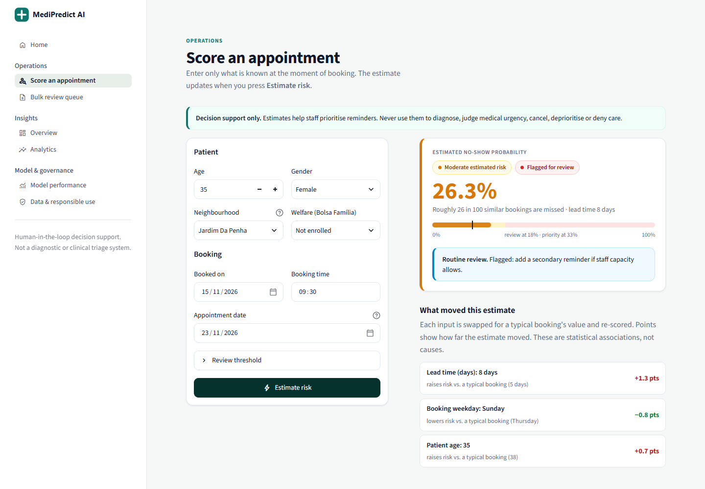
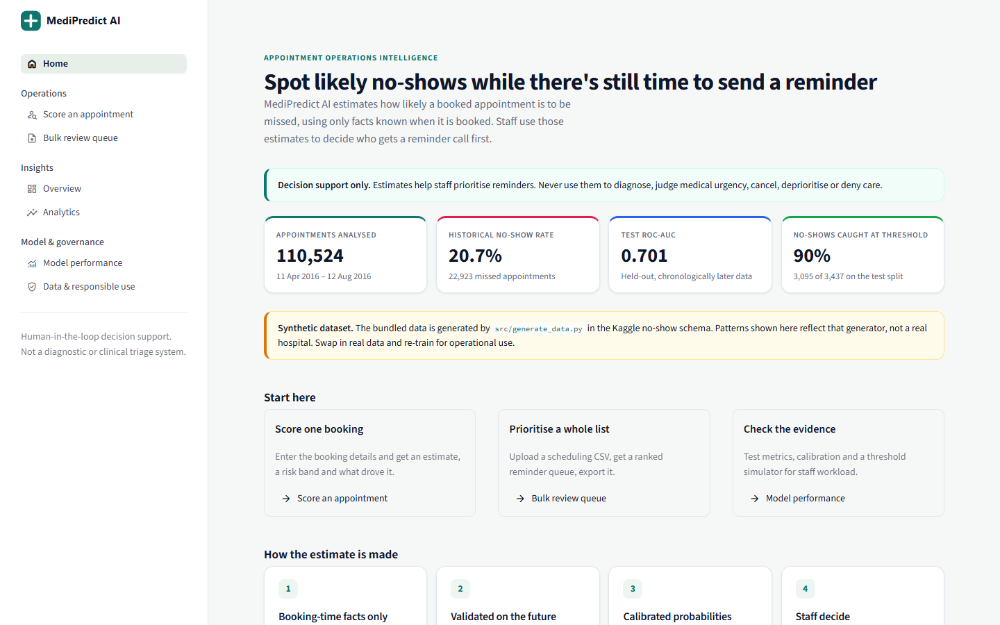
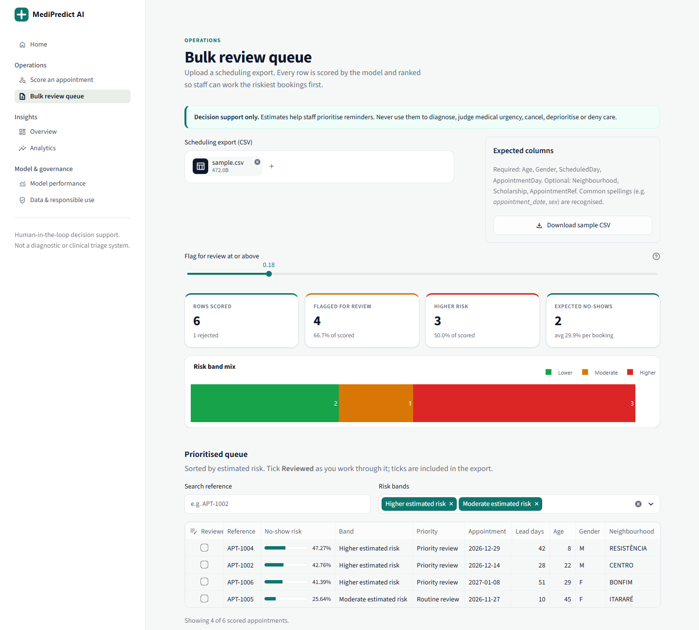
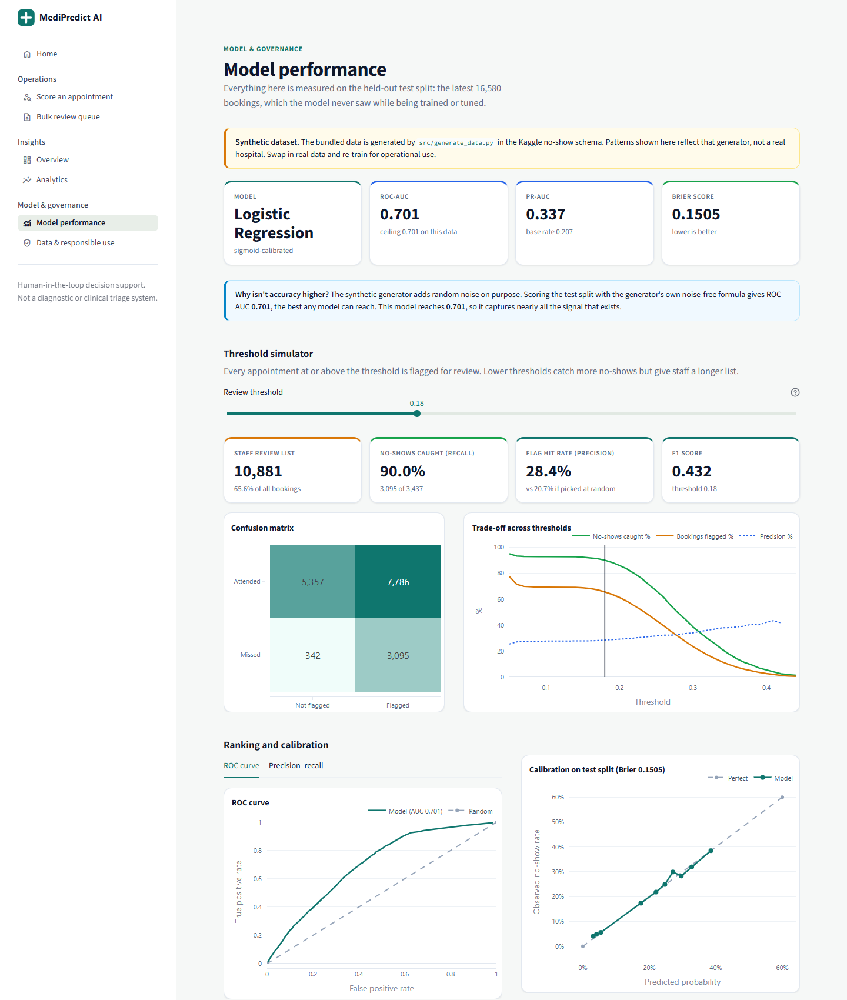
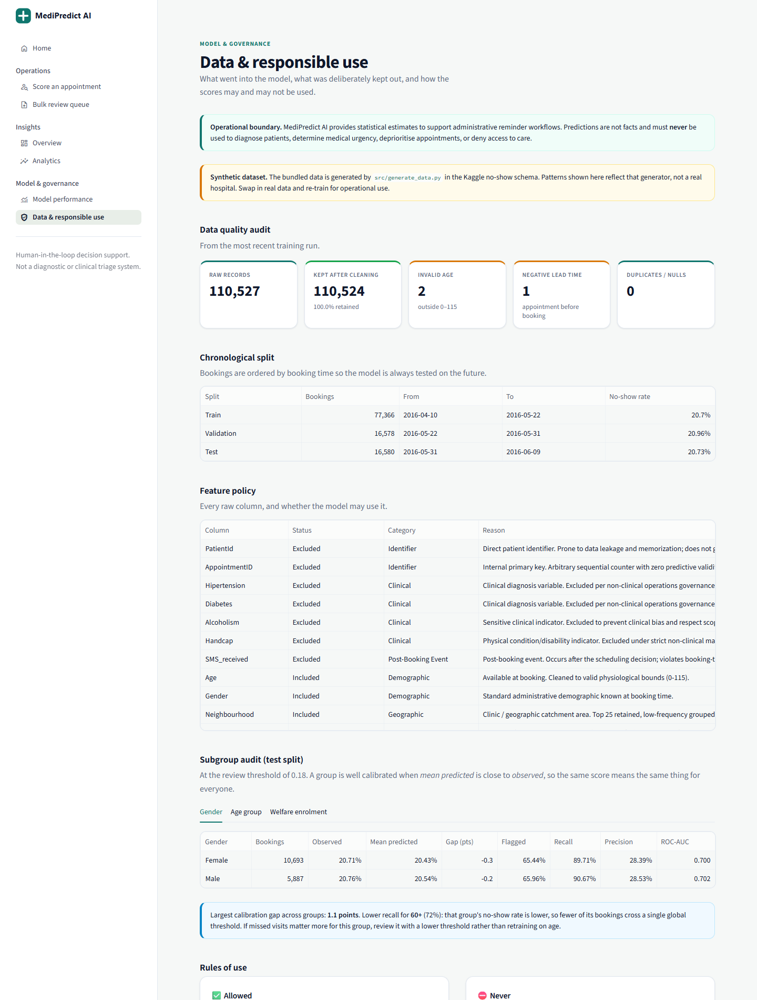
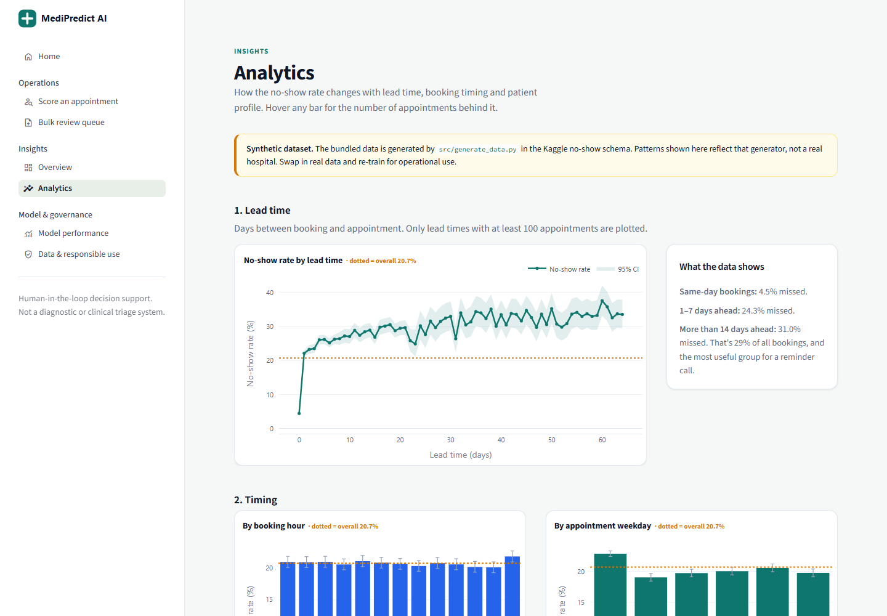
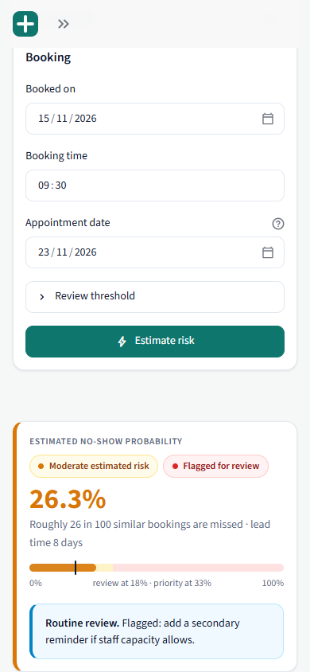

# MediPredict AI

### Hospital Appointment No-Show Prediction & Appointment Operations Intelligence

> **Project Type:** AI/ML Internship Assessment Project  
> **Organization:** ALGIONS AI LABS PRIVATE LIMITED  
> **Primary Interface:** Streamlit (Multi-Page Web Dashboard)  
> **Theme:** Clinical Light  


[](https://medipredict-ai.streamlit.app)

> 🚀 **Live Demo:** Try the interactive application live on Streamlit Community Cloud: [medipredict-ai.streamlit.app](https://medipredict-ai.streamlit.app)



### At a glance

| | |
| :--- | :--- |
| **Problem** | Estimate, at booking time, how likely an appointment is to be missed, so staff call the right patients first |
| **Data** | 110,524 bookings after cleaning (synthetic, Kaggle schema), 20.7% no-show rate |
| **Validation** | Chronological 70 / 15 / 15 split by booking time; test split scored once |
| **Model** | Calibrated logistic regression, picked over Random Forest and HistGradientBoosting on validation |
| **Test result** | ROC-AUC **0.701** (data ceiling 0.701), recall **90%** at the review threshold, Brier **0.1505** |
| **Trust** | Leakage audit, per-group calibration audit, model-based per-booking explanations |
| **App** | 7-page Streamlit app (single + bulk scoring, analytics, threshold simulator), phone to desktop |
| **Quality** | 25 tests, page smoke test, ruff lint, GitHub Actions CI, Docker |

---

## 1. Executive Summary & Problem Formulation

Missed clinical appointments waste healthcare capacity, inflate waiting lists, and degrade operational efficiency. **MediPredict AI** is a human-in-the-loop decision-support platform designed to estimate the probability that a scheduled hospital appointment will be missed, allowing authorized administrative staff to prioritize manual reminder outreach.

```
Supervised Binary Classification:
- Target Class (1): No-Show (Missed appointment)
- Majority Class (0): Attended (Kept appointment)
- Prediction Moment: Exactly when the appointment is booked (ScheduledDay)
- Intended Action: Prioritize reminder review; NO automatic cancelation
```

> [!IMPORTANT]
> **Operational Decision Support Boundary:**  
> MediPredict AI is an administrative tool. It is **not** a clinical diagnostic system and must **never** be used to diagnose patients, determine medical urgency, deprioritize appointments, or deny care.

---

## 2. Goals & Non-Goals

### Goals
- **Strict Point-in-Time Discipline:** Use only operational and demographic features known at appointment booking time.
- **Leakage Prevention:** Eliminate patient identifiers and post-booking operational events.
- **Chronological Validation:** Train/Validation/Test split ordered strictly by `ScheduledDay` (70% Train, 15% Validation, 15% Test) with zero temporal overlap.
- **Calibrated Inference:** Output true empirical probability estimates rather than distorted raw scores.
- **Decision Threshold Optimization:** Tune operating thresholds on validation data to balance recall and staff workload.
- **Production Artifact:** Save a complete end-to-end `sklearn.pipeline.Pipeline` with schema validation and test coverage.

### Non-Goals & Prohibited Uses
- ❌ **No clinical triage or diagnosis:** Sensitive diagnostic variables (`Hipertension`, `Diabetes`, `Alcoholism`, `Handcap`) are strictly excluded.
- ❌ **No automated cancellations or access barriers:** Staff make all decisions; the system provides informational risk bands only.
- ❌ **No double-booking over-allocation:** Risk scores must not be used to over-schedule clinics.
- ❌ **No causal claims:** Model factors reflect statistical associations, not causes.

---

## 2a. Key Design Decisions

| Decision | Why |
| :--- | :--- |
| Split by booking time, not at random | Random splits let the model see the future; a chronological split mirrors deployment. |
| Exclude `SMS_received` | It is recorded after booking. In the data it *looks* predictive (17% vs 28.7% no-show) but within the same lead-time band the gap disappears (see `notebooks/01_eda.ipynb`). |
| Calibrate, then tune the threshold | Staff read the number as a probability, so 30% must mean ~3 in 10. Calibration is checked on the untouched test split. |
| Logistic regression over trees | Equal validation performance, faster, easier to explain, and reaches the data's ceiling once lead time is log-scaled. |
| Bands learned from data | Lower = below the review threshold, Higher = top 15% of validation risk, so a band and the review flag never disagree. |
| Explanations by re-scoring | Each input is replaced with a typical booking's value and the model re-scores, so explanations come from the model, not hand-written rules. |
| Report the ceiling | On synthetic data we can compute the best achievable ROC-AUC; reporting it shows the model is not leaving signal on the table. |

## 2b. Limitations & Next Steps

- **Synthetic data.** Metrics describe the generator. Re-train on the real Kaggle file or hospital data before any use.
- **Wide default net.** The F1-optimal threshold flags ~66% of bookings. A capacity-based threshold (e.g. "we can make 200 calls a day") is the natural next step; the simulator already shows the trade-off.
- **Lower recall for patients 60+** (72% vs ~90% elsewhere) because their base rate is lower. A group-specific review threshold would close the gap without adding sensitive features.
- **No patient history.** Prior no-shows are a strong real-world signal and are known at booking time; adding them (computed strictly before each booking) is the first feature to try on real data.
- **Monitoring.** Track flag rate, calibration and per-group recall monthly, and re-train when they drift.

---

## Screens

| Home | Bulk review queue |
| :---: | :---: |
|  |  |
| **Model performance** | **Data & responsible use** |
|  |  |
| **Analytics** | **Mobile** |
|  |  |

---

## 3. Repository Architecture

```text
MediPredict-AI/
├── app.py                     # Streamlit entrypoint: st.navigation router + design system
├── streamlit_app.py           # Streamlit Cloud default entrypoint (runs app.py)
├── app_pages/
│   ├── home.py                # What the tool does, live headline numbers, risk bands
│   ├── single_prediction.py   # Score one booking, with model-based explanations
│   ├── bulk_prediction.py     # Upload a CSV, ranked reminder queue, review ticks, export
│   ├── overview.py            # Historical volume and attendance (filterable)
│   ├── analytics.py           # No-show rate by lead time, timing, profile (with 95% CIs)
│   ├── model_performance.py   # Test metrics, threshold simulator, ROC/PR, calibration
│   └── responsible_use.py     # Data-quality audit, split, feature policy, rules of use
├── src/
│   ├── config.py              # Paths, feature policy, band rules, theme tokens
│   ├── generate_data.py       # Synthetic Kaggle-schema generator (+ noise-free reference)
│   ├── data_preprocessing.py  # Schema validation, date parsing, anomaly filtering
│   ├── feature_engineering.py # Point-in-time features, chronological split
│   ├── train_model.py         # Candidates, calibration, threshold, bands, metadata, report
│   ├── predict.py             # Validated single + vectorised batch inference, explanations
│   ├── batch_schema.py        # CSV column aliasing + sample template
│   └── ui_components.py       # CSS, KPI grid, badges, callouts, Plotly style, cached loaders
├── data/raw/appointments.csv  # 110,527 synthetic records (Kaggle schema)
├── models/                    # appointment_pipeline.joblib + model_metadata.json
├── reports/model_evaluation.md# Auto-generated evaluation report
├── notebooks/01_eda.ipynb
├── tests/                     # 25 unit/integration tests + smoke_app.py (renders every page)
├── docs/screenshots/          # README / landing-page screenshots
├── index.html                 # GitHub Pages landing page (reads models/model_metadata.json)
└── .github/workflows/ci.yml   # lint + tests + page smoke test
```

> [!NOTE]
> The bundled dataset is **synthetic**, produced by `src/generate_data.py`. Its no-show label comes from a known formula
> plus random noise, so every number below describes that generator, not a real hospital. To use real data, drop the
> Kaggle *Medical Appointment No Shows* CSV (same schema) at `data/raw/appointments.csv`, set `DATA_IS_SYNTHETIC = False`
> in `src/config.py`, and re-train.

---

## 4. Point-in-Time Feature Dictionary & Policy

| Feature | Status | Notes |
| :--- | :--- | :--- |
| `PatientId`, `AppointmentID` | **Excluded** | Identifiers |
| `Hipertension`, `Diabetes`, `Alcoholism`, `Handcap` | **Excluded** | Clinical / disability data, out of scope |
| `SMS_received` | **Excluded** | Happens after booking (leakage) |
| `Age`, `Gender`, `Scholarship` | Included | Known at booking |
| `Neighbourhood` | Included | Top 25 from the training split; the rest become `Other` |
| `waiting_days`, `log_waiting_days`, `is_same_day` | Derived | Lead time from `ScheduledDay` → `AppointmentDay` |
| `scheduled_hour`, `scheduled_day_of_week`, `appointment_day_of_week` | Derived | Booking and appointment timing |

---

## 5. Model Training & Evaluation Summary

Chronological split by `ScheduledDay`: 70% train (77,366), 15% validation (16,578), 15% test (16,580).

### Candidates (validation split)
| Model | ROC-AUC | PR-AUC | F1-optimal threshold | F1 |
| :--- | :--- | :--- | :--- | :--- |
| Dummy (prior) | 0.500 | 0.210 | – | 0.347 |
| **Logistic Regression** | **0.696** | **0.338** | 0.51 | 0.430 |
| Random Forest | 0.694 | 0.334 | 0.50 | 0.430 |
| HistGradientBoosting | 0.694 | 0.339 | 0.45 | 0.428 |

The best (ROC-AUC + PR-AUC) candidate is then sigmoid-calibrated on validation (Brier 0.2245 → 0.1520), and the
review threshold is re-tuned on the calibrated probabilities.

### Held-out test split — `Logistic Regression (Calibrated)`, threshold 0.18
| Metric | Value |
| :--- | :--- |
| ROC-AUC / PR-AUC | **0.701** / 0.337 |
| Synthetic-data ceiling (noise-free generator formula) | 0.701 / 0.339 |
| Recall | 90.0% (3,095 of 3,437 no-shows) |
| Precision | 28.4% (base rate 20.7%) |
| Share of bookings flagged | 65.6% |
| Brier score | 0.1505 |

The model reaches the ceiling on this data, so more complex models cannot raise accuracy here; the remaining
error is the generator's random noise. The F1-optimal threshold casts a wide net (two-thirds of bookings), so teams
with limited call capacity should start from the **Higher** band or raise the threshold in the simulator.

---

## 6. Risk Bands

Bands are learned at training time and stored in `models/model_metadata.json`, so they always agree with the review flag.

| Band | Rule | Test bookings | Observed no-show rate | Suggested action |
| :--- | :--- | :--- | :--- | :--- |
| Lower | p < threshold (0.18) | 5,699 | 6.0% | Standard automated reminder |
| Moderate | 0.18 ≤ p < 0.33 | 8,423 | 25.8% | Secondary reminder if capacity allows |
| Higher | p ≥ 0.33 (top 15% of validation risk) | 2,458 | 37.4% | Priority staff call ~48h before. Never auto-cancel |

---

## 7. Quickstart

```bash
git clone https://github.com/madrewarparth/MediPredict-AI.git
cd MediPredict-AI
python -m venv .venv
.venv\Scripts\activate          # Windows  (macOS/Linux: source .venv/bin/activate)
pip install -r requirements.txt

# optional: rebuild data/model (artifacts are committed)
python -m src.generate_data     # only if data/raw/appointments.csv is missing
python -m src.train_model       # ~1–2 min; writes models/ and reports/

streamlit run app.py            # http://localhost:8501
```

Docker: `docker build -t medipredict . && docker run -p 8501:8501 medipredict`

### Bulk CSV format
Required columns: `Age`, `Gender`, `ScheduledDay`, `AppointmentDay`. Optional: `Neighbourhood`, `Scholarship`,
`AppointmentRef`. Common spellings (`appointment_date`, `sex`, `booking_date`, …) are recognised. Rows that fail
validation are listed with a reason rather than silently dropped. A sample file is downloadable from the page.

---

## 8. Testing

```bash
python -m pytest -q              # 25 passed
python tests/smoke_app.py        # renders all 7 pages headlessly
ruff check .                     # lint
```

Covers schema validation, anomaly filters, leakage guards, chronological split, single/batch parity, row-order
preservation, band/flag consistency, column aliasing (including the Neighbourhood regression), model-based
explanations and unseen-weekday warnings.

---

## 9. Design System

Clinical Light: primary teal `#0F766E`, background `#F6F8F7`, text `#0F172A`, muted `#5B6B7F`, border `#E2E8F0`;
risk colours Lower `#16A34A`, Moderate `#D97706`, Higher `#DC2626`. KPI cards use a CSS grid that drops to two
columns on phones and one column under 380px.

---

## 10. Credits & Disclaimer

This project was built as an assessment prototype for **ALGIONS AI LABS PRIVATE LIMITED**.

**MediPredict AI provides estimates for human administrative review only. It is not a clinical tool, does not determine medical urgency, and must never be used to deny or restrict healthcare access.**
